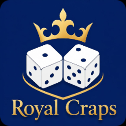
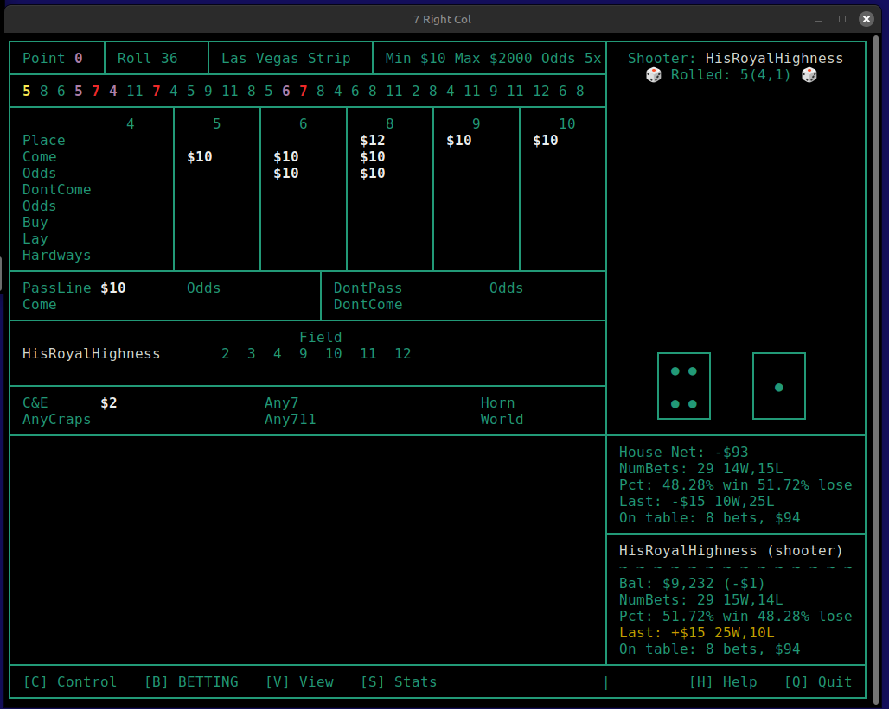

<!---
Comments here if needed.
-->

<h1 align="center">Royal Craps</h1>

<p align="center">
  
</p>

<p align="center">
  <b>Play real casino craps in your terminal.</b><br>
  Full table, real rules, real odds, and a few friends at the rail.
</p>

---

[](https://github.com/kingsolomon1954/craps/actions/workflows/build.yml)
[](https://github.com/kingsolomon1954/craps/releases)
[](https://kingsolomon1954.github.io/craps/code-coverage/html/index.html)
[](https://kingsolomon1954.github.io/craps/static-analysis/report/index.html)

## What is Royal Craps?
Royal Craps is a craps game for the Linux terminal. It plays the game the
way a casino table does: the full layout, the real payouts, the house
commission on buy bets, and table limits with the odds you would find on
the Las Vegas Strip. Pull up to the table, shoot the dice, and watch your
bankroll rise and fall roll by roll.

It is for people who want to learn craps without risking a dollar, for
players who want to try a betting system and see how it really does over
thousands of rolls, and for anyone who likes the sound of the dice.

## Game Features

**The Table**
- The complete layout: Pass and Don't Pass, Come and Don't Come, Odds,
  Place, Buy, Lay, Field, Hardways, and the one-roll Proposition bets
- Choose between tables, such as the Las Vegas Strip and a High Roller
  table with higher limits and odds
- Animated dice and a running history of rolls

**Play Your Way**
- Up to five computer buddy players share the table with you
- Keep several players, each with a bankroll and a history of their own
- Quick Bets: a whole set of bets in one keystroke
- Automatic Odds: take or lay your odds behind line bets for you
- Bet Flags: mark bets to stay up, come down, or work only on the next roll
- Undo your bets while betting is open

**Know How You Are Doing**
- Win and loss records for the current session and across all sessions
- Statistics for the player, the table, and the dice
- Your players and tables are saved between sessions

**Under the Hood**
- A terminal interface built with ncurses (a graphical interface is planned)
- Written in C++20, with unit tests and documentation built with the code

## Sample Screen Shot
<p align="center">
  
</p>

## Installation
To be supplied

## Published Documentation (GitHub Pages)
- [Documentation Top](https://kingsolomon1954.github.io/craps/index.html)
- [User Guide](https://kingsolomon1954.github.io/craps/user-guide/user-guide.html)
- [ManPage](https://kingsolomon1954.github.io/craps/manpage/manpage.html)
- [Design Doc](https://kingsolomon1954.github.io/craps/design-doc/design-doc.html)
- [Doxygen API](https://kingsolomon1954.github.io/craps/doxygen/html/index.html)
- [Static Analysis](https://kingsolomon1954.github.io/craps/static-analysis/report/index.html)
- [Code Coverage](https://kingsolomon1954.github.io/craps/code-coverage/html/index.html)
- [Licenses](https://kingsolomon1954.github.io/craps/licenses/licenses.html)

## Building
The build runs in a Podman or Docker container, so you need only
`make` and a container engine on your machine.

```bash
make              # debug build
make prod         # optimized build
make unit-test-debug
```
See the header of the top-level `Makefile` for more.

## Development
- Project setup from KingSolomon1954/cpp-bootstrap
- GNU Makefile
- Podman or Docker
- C++, CMake, Conan, ncurses
