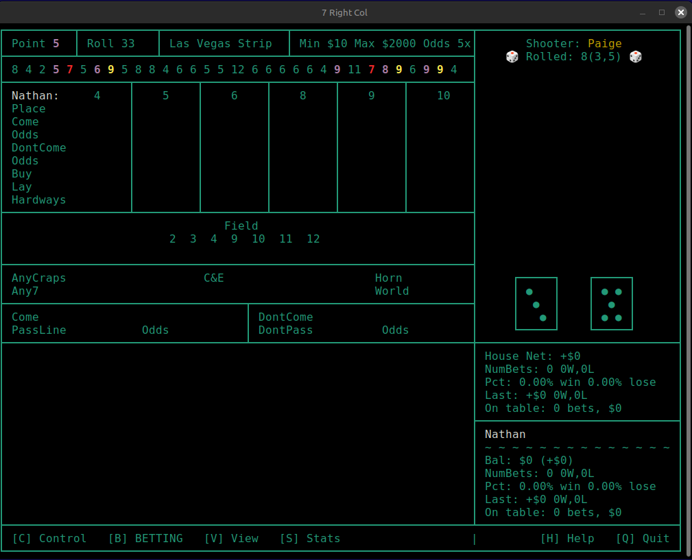

<!---
Comments here if needed.
-->

<h1 align="center">Royal Craps</h1>

  

Single-player Craps Game

---

## Game Features
- Line, Odds, Place, Field, and Proposition Bets
- Automatic Odds
- Quick Bets
- Play with Up to Five Computer Buddies
- On-Screen Dice Roll Animation
- Dice Roll history
- Dice Stats
- Player Stats Current Session
- Player Stats Across All Sessions
- Table Stats Current Session
- Table Stats All Sessions
- Terminal Based UI (future GUI)

## Sample Screen Shot

  

## Installation
To be supplied

## Development
- Project setup from KingSolomon1954/cpp-bootstrap
- GNU Makefile
- Podman or Docker
- C++, ncurses
